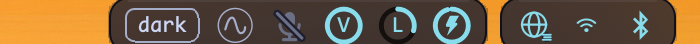

<div align="center">
  
  <h1>lo</h1>
  <p><strong>A ring-first Hyprland top bar — clock, workspaces, system, AI quota, network and proxy in one Quickshell process</strong></p>
  <p>
    <a href="README.md">English</a> | <a href="README.zh-CN.md">简体中文</a>
  </p>
  <p>
    <a href="https://github.com/kimiellen/lo/releases/latest">
      
    </a>
    
    
    
    
    
  </p>
</div>


lo is a Hyprland top bar written entirely in QML on **Quickshell 0.3.2 / Qt 6.12**. It runs as one long-lived process, turns usage into rings, and keeps the things you actually glance at within reach:

1. **Clock and system at a glance** — a bilingual date/time card with an ISO week badge, workspace rings, CPU / memory / disk, volume / brightness / battery
2. **AI quota on the bar** — Kimi Code 7-day and 5-hour windows with their own reset countdowns, plus your DeepSeek balance
3. **Network and proxy** — iwd Wi-Fi with inline password entry, BlueZ devices, and mihomo proxy modes in one control panel
4. **Your theme, your language** — Catppuccin Mocha / Latte / auto and 中文 / English, switched live and persisted

Nothing on the bar is allowed to break the bar: a missing API key, a failed `df`, an absent battery or an unreachable mihomo only greys out that one item.

## Features

### Left cluster — clock, system rings, quota


#### Clock

- One card at the left edge; the bar's fixed centre is reserved for workspaces
- Grouped as calendar + date → clock + time → ISO week badge + weekday; both languages use 24-hour time
- 中文 `11月1日 / 21:26 / 45 / 周一` · English `1 Nov / 21:26 / 45 / Mon` (`45` is the ISO week)
- `SystemClock` updates it every second; the calendar/clock glyphs stay in subtext, and the ISO week number sits in a subtext-outlined pill with a transparent fill

#### CPU / memory / disk

- Three rings lettered `C`, `M`, `D`; sky below 80 % usage and peach at 80 % and above; hover for the exact percentage and, for memory and disk, `used / total` in GiB
- CPU is the delta of two `/proc/stat` samples every second; memory reads `MemAvailable` every two seconds; disk measures `/` every 30 seconds with the same accounting as `df`
- Clicking any ring opens the control panel; if a source disappears the ring turns grey and shows `--` instead of freezing on a stale value

#### Kimi Code quota

- Fetches `GET https://api.kimi.com/coding/v1/usages` every 60 seconds and renders the **windows the API actually returns** — no hard-coded window list
- Up to two rings, picked in a fixed visual order: **7-day first, then 5-hour**, with monthly / code windows as a fallback so a changed API never hides the quota
- Every ring shares the two-tier usage colours with the system rings (sky below 80 %, peach at 80 % and above). Each ring carries its own reset countdown in the body text colour: days for the weekly window (`1D`, `3D`), hours for the session window (`3H`)
- Hover shows the window name, percentage and reset time
- The parser accepts the current `usages` shape, the older `usage` shape and `limits[]`, plus `used_ratio`, `used/limit` and `remaining/limit`
- Key comes from `KIMI_CODING_API_KEY` or `~/.config/vbc-io/secrets.json` (`600`, `400` also accepted); missing key, 401, timeout or garbage all degrade to a grey `--` ring and recover on the next poll

#### DeepSeek balance

- Fetches `GET https://api.deepseek.com/user/balance` every 60 seconds
- A balance has no denominator, so it is deliberately **not** a ring: the official DeepSeek vector mark plus the amount, with `¥` / `$` taken from the API currency
- `is_available: false` keeps the number but switches it to the warning colour; failures show `--`

### Center — workspaces

- One ring per workspace slot, numbered from 1 and always at least five; empty slots show only the track arc in the calendar-glyph colour (subtext), and a higher workspace ID grows the row
- Each ring always draws five 72° slots with a small gap between segments. One window occupies one slot; occupied slots use sky, empty slots use the calendar-glyph colour (subtext), and gaps stay transparent — no per-app colours or colour editor
- The active window's segment always sits at 12 o'clock; the whole ring rotates continuously when the active window changes or windows move, without replaying the animation when the first/last state is unchanged
- `N < 5` shows every window; `N >= 5` always draws exactly five. Once the active window is past the fifth position the view slides so the active window is the last visible one — there is no `+N` badge
- The red radius line marks the start of the visible five-window window and rotates with the ring
- The selected workspace gets a peach outer ring (26 px diameter, 2 px stroke) centred in its 30 px slot
- Left-click a non-focused workspace to switch through Hyprland's Lua `eval`; clicking the current workspace does nothing
- Workspaces appear and disappear with Hyprland events — no polling, no restart

### Right cluster — status card and status icons



**Status card**

- **Theme button** — cycles `dark → light → auto`; `auto` picks light between 06:00 and 18:00 and dark otherwise, and follows the clock while the bar runs
- **Microphone** — mutes / unmutes the default input; the glyph gains a slash and turns grey when muted
- **Volume** — ring lettered `V` in sky; click the ring to mute, scroll to change volume by 5% (muted greys the whole ring)
- **Brightness** — ring lettered `L` in sky; scroll to change by 5%, with the value rounded to the same integer shown elsewhere
- **Battery** — ring lettered `B` that swaps to a bolt vector while plugged in; the arc and centre are sky at 50 % and above, peach below; hover shows percent, remaining time and wattage
- Missing hardware hides the module instead of showing a broken one (no PipeWire → no volume module, no backlight → no brightness)

**Status icons**

- Proxy, Wi-Fi and Bluetooth; each opens the control panel on its own tab
- Proxy uses a 24 px vector globe with a mode badge (rule / global / direct); Wi-Fi and Bluetooth use Nerd Font glyphs
- Proxy is sky when mihomo is configured and reachable, grey otherwise. Wi-Fi and Bluetooth are sky when connected, `subtext` when powered but not connected, and grey when off or unavailable (Bluetooth hides if BlueZ is absent)

## Control panel

The panel is a 400 px overlay anchored under the right edge of the bar. `Esc` or a click outside closes it, and it takes exclusive keyboard focus while open so the Wi-Fi password field can be typed into. Opening a tab refreshes that tab's data immediately; the panel height follows its content between 140 and 640 px.

### Proxy

- Reads `external-controller` and `secret` from `/etc/mihomo/config.yaml`; if the file cannot be read, falls back to `mihomoController` / `mihomoSecret` in `config.json`
- Switches `rule` / `global` / `direct` through `PATCH /configs` — mihomo 1.19.33 accepts `PUT` with 204 but does not apply it
- Shows the current node, the strategy group it was resolved from, and the TUN state; TUN and node selection are read-only in V1
- A manual refresh button re-reads `/configs` and `/proxies` on demand

### Network

- Wi-Fi power switch, connected network with IP and signal, and a scan button
- Saved or open networks connect directly; WPA networks open an inline password field — the panel keeps keyboard focus exactly for this
- Unsupported security types and failed connections report inline, without throwing
- A read-only link table (`ip -br addr`) lists every interface with state and addresses, refreshed every five seconds

### Bluetooth

- Adapter power switch, connected devices with battery percentage, and available / paired devices
- Search starts a 15-second discovery and stops automatically, because BlueZ has no manual refresh
- Each row carries an explicit connect / disconnect button; clicking a disconnected device's name connects it too — a connected device's name is inert, so you can't fat-finger a disconnect
- BlueZ auto-reconnects BLE/HID devices right after a manual disconnect (controller accept list), so a disconnect also blocks the device until the next connect
- The list re-sorts by name as states change

## Themes and languages

|  | Mocha (dark) | Latte (light) |
|---|---|---|
| Base | `#1e1e2e` | `#eff1f5` |
| Text | `#cdd6f4` | `#4c4f69` |
| Ring accent | sky `#89dceb` | sky `#04a5e5` |
| Workspace focus | peach `#fab387` | peach `#fe640b` |
| UI accent | lavender `#b4befe` | lavender `#7287fd` |
| Status icons | sky when healthy, `subtext` when idle, `overlay` when off | same roles |
| Battery tiers | sky (`≥50%`) / peach (`<50%`) | same roles |

- sky is the "normal" colour for gauges and connected states; peach is the one attention colour — the selected workspace ring, any usage ring at 80 %+, and a battery below 50 %
- The UI accent is used for panel controls such as toggles, links and the active proxy-mode outline
- Every visible string goes through `I18n`; every colour goes through `Theme` — there are no hard-coded labels or hex values in the bar
- Theme and language are written to `~/.config/vbc-io/config.json` and restored before the first frame, so rings never flash in the wrong palette on startup
- Both can also be driven from the shell with IPC (see below)

Screenshots use the English UI and the Mocha palette; Latte changes only the palette, and Chinese changes only strings and date formatting.

## Interactions

| Element | Left click | Scroll | Hover |
|---|---|---|---|
| Workspace ring | switch to that workspace (current workspace: no-op) | — | workspace number and window count |
| CPU / memory / disk ring | open the control panel | — | percentage, and `used / total` for M and D |
| Kimi quota ring / countdown | — | — | window, percentage, reset time |
| DeepSeek balance | — | — | amount or the failure reason |
| Theme button | dark → light → auto | — | current mode |
| Microphone | toggle input mute | — | muted / on |
| Volume ring | toggle mute | ±5% | percentage, or `Muted` |
| Brightness ring | — | ±5% | percentage |
| Battery ring | — | — | percentage, remaining time, wattage |
| Status icon (proxy / Wi-Fi / Bluetooth) | open its panel tab | — | proxy mode and node, SSID, connected device count |
| Clock | — | — | — |

## Requirements

| Requirement | Version | Notes |
|---|---|---|
| Hyprland | 0.57+ | Tested on 0.57.0; workspace switching goes through Lua `eval` |
| Quickshell | 0.3.2 | Arch package; Qt 6.12 |
| PipeWire | any | Volume and microphone modules; `pactl` not required |
| UPower | any | Battery module |
| BlueZ | any | Bluetooth tab |
| iwd | any | Wi-Fi tab — **NetworkManager is not used** |
| `brightnessctl` | any | Brightness module |
| `curl` | any | Kimi, DeepSeek and mihomo requests |
| `iproute2` | any | Link table in the network tab |
| mihomo | optional | Proxy tab; reads `external-controller` and `secret` |
| JetBrainsMono Nerd Font | any | Status glyphs; Noto Sans CJK for Chinese |

## Installation

> **Naming:** the project is `lo`, but the Quickshell config identifier stays `vbc-io` (`qs -c vbc-io`, `~/.config/vbc-io/`). Renaming it would break existing installs, so it is intentionally stable.

### 1. Dependencies

On Arch:

```bash
sudo pacman -S quickshell pipewire upower bluez bluez-utils iwd brightnessctl curl iproute2
sudo pacman -S ttf-jetbrains-mono-nerd noto-fonts-cjk
```

The proxy tab is optional: install mihomo separately and make sure its `external-controller` is reachable. The bar works without it.

### 2. Clone into the Quickshell config directory

```bash
git clone https://github.com/kimiellen/lo.git ~/.config/quickshell/vbc-io
```

The directory name must be `vbc-io`: Quickshell derives the `qs.*` import namespace from it, and `qs -c vbc-io` looks there.

### 3. API keys

Create `~/.config/vbc-io/secrets.json`:

```json
{
  "kimi_api_key": "your-kimi-coding-key",
  "deepseek_api_key": "your-deepseek-key"
}
```

```bash
chmod 600 ~/.config/vbc-io/secrets.json
```

Only `600` and `400` are accepted; anything looser is refused and the quota modules stay grey. Environment variables `KIMI_CODING_API_KEY` and `DEEPSEEK_API_KEY` take precedence and are the better choice if you already export them.

### 4. Run it

```bash
qs -c vbc-io
```

The bar appears immediately; QML edits hot-reload while it runs. For autostart, add to `~/.config/hypr/hyprland.conf`:

```ini
exec-once = qs -c vbc-io
```

### Updating

```bash
cd ~/.config/quickshell/vbc-io
git pull
```

Quickshell picks up the new QML on the next reload; no build step exists.

## Configuration

`~/.config/vbc-io/config.json` is written whenever a setting changes. Every key is optional:

| Key | Default | Meaning |
|---|---|---|
| `theme` | `"mocha"` | `mocha`, `latte` or `auto` (`auto` = light 06:00–18:00) |
| `language` | `"zh"` | `"zh"` or `"en"` |
| `barHeight` | `32` | Card height, clamped to 28–64; the bar window adds margins on top |
| `mihomoConfigPath` | `/etc/mihomo/config.yaml` | mihomo config used to discover `external-controller` / `secret` |
| `mihomoController` | `""` | Fallback controller URL when the config file cannot be read |
| `mihomoSecret` | `""` | Fallback secret for that controller |
| `secretsPath` | `<config dir>/secrets.json` | Override the quota key file |

```json
{
  "theme": "auto",
  "language": "en",
  "barHeight": 32,
  "mihomoConfigPath": "",
  "mihomoController": "",
  "mihomoSecret": "",
  "secretsPath": ""
}
```

Set `VBCIO_CONFIG_DIR` to point the whole config directory somewhere else — useful for trying a theme or a language without touching your daily setup.

## IPC

The running instance is selected with `-c vbc-io`; `qs ipc call` alone looks for a `default` config and will not find it.

```bash
qs -c vbc-io ipc call theme toggle       # dark → light → auto
qs -c vbc-io ipc call theme set latte    # mocha / latte / auto
qs -c vbc-io ipc call language toggle    # zh ↔ en
qs -c vbc-io ipc call language set en
qs -c vbc-io ipc call workspaces focus 3 # jump to workspace 3
```

Handy for keybindings:

```ini
bind = SUPER, T, exec, qs -c vbc-io ipc call theme toggle
bind = SUPER, L, exec, qs -c vbc-io ipc call language toggle
```

## How it works

```text
lo/
├── shell.qml            # ShellRoot: one Bar + one Panel per screen, plus IPC
├── core/                # Theme, I18n, Config, Format, Metrics — no side effects
├── services/            # every external read/write: Hypr, SystemStats, Audio,
│                        #   Brightness, Power, Wifi, Link, BlueZ, Proxy,
│                        #   QuotaKimi, QuotaDeepSeek, Secrets
├── components/          # UsageRing, InfoRing, StatusGlyph, ProxyGlyph,
│                        #   CalendarGlyph, ClockGlyph, Tooltip…
├── bar/                 # three-zone layout and its items
├── panels/              # panel host and proxy / network / bluetooth tabs
└── docs/specs/topbar/   # spec.md is the source of truth
```

Two rules keep the codebase honest:

- **UI never performs side effects.** Commands, file reads and HTTP live only in `services/`; the bar and panels only bind to properties.
- **No magic values in views.** Colours come from `Theme`, strings from `I18n`, sizes from `Metrics`, numbers from `Format`.

### Data sources

| Module | Source | Refresh | When unavailable |
|---|---|---|---|
| Workspaces | `Quickshell.Hyprland` | events | hidden |
| CPU | `/proc/stat` (two samples) | 1 s | `--` |
| Memory | `/proc/meminfo` (`MemAvailable`) | 2 s | `--` |
| Disk | `df -P /` | 30 s | `--` |
| Volume / mic | `Quickshell.Services.Pipewire` | events | hidden |
| Brightness | `brightnessctl -m` | 1 s | hidden |
| Battery | UPower `displayDevice` | events | hidden |
| Kimi quota | `api.kimi.com/coding/v1/usages` | 60 s | grey `--` |
| DeepSeek balance | `api.deepseek.com/user/balance` | 60 s | `--` |
| Proxy | mihomo `/configs` + `/proxies` | 5 s | grey icon |
| Wi-Fi | `iwctl` | 10 s + on open | offline icon |
| Links | `ip -br addr` | 5 s | empty table |
| Bluetooth | `Quickshell.Bluetooth` | events | hidden |

HTTP is always a `curl` child process with `--max-time 8`. Parsing failures are logged once and degrade the module; they never throw into the UI.

### Degradation, by design

- A missing key shows `--` and a grey ring, and the module recovers on the next poll once the key is back — no restart
- `secrets.json` with permissions wider than `600/400` is refused rather than read
- Missing hardware hides the module; it does not render a zero
- An unreachable mihomo greys the proxy icon and shows the reason in the proxy tab
- The control panel's height follows its content, clamped between 140 and 640 px

## Visual system

Everything is Catppuccin, with semantic roles instead of raw colours:

| Role | Mocha | Latte | Used by |
|---|---|---|---|
| `sky` | `#89dceb` | `#04a5e5` | volume, brightness, occupied workspace segments, healthy status icons; usage rings below their threshold |
| `peach` | `#fab387` | `#fe640b` | selected workspace outer ring; usage rings ≥80 %; battery <50 % |
| status healthy | sky | sky | proxy / Wi-Fi / Bluetooth icons |
| status idle | `subtext` | `subtext` | Wi-Fi / Bluetooth powered but not connected |
| status off | `overlay` | `overlay` | off or unavailable |
| battery tier | sky ≥50 % / peach <50 % | same | battery ring and centre; plugged in swaps `B` for a bolt |
| `deepseekBrand` | `#4d6bfe` | `#4d6bfe` | DeepSeek mark |
| UI accent | lavender `#b4befe` | lavender `#7287fd` | toggles, links, active proxy-mode outline |

Geometry is a small, fixed vocabulary:

| Token | Value |
|---|---|
| Card | 32 px tall, radius 12, 10 px horizontal padding; frosted — 72% base over a blurred backdrop (ext-background-effect-v1), 1 px crust stroke plus a 1 px top highlight on dark, 1 px text 10% stroke on light |
| Ring | 24 px outer diameter, 3 px stroke |
| Workspace | 30 px slot, 20 px inner ring / 3 px stroke; selected outer ring 26 px / 2 px, peach |
| Bar text | 14 px everywhere; panel text 11–13 px |
| Status icons | 24 px box, 22 px glyph |
| Theme button | 22 px tall |
| Bar margins | `max(15, gaps_out + 5)` left/right, `max(12, gaps_out + 2)` top/bottom, 8 px between cards |
| Panel | 400 px wide, radius 12, 12 px padding, 30 px tabs; height 140–640 px |

At fractional scaling a 24 px ring lands on 38.4 device pixels, so the bar **snaps geometry to device pixels**: card height, margins, gaps, ring diameters and 1 px borders are all rounded to whole device pixels (`Metrics.snap` / `snapEven`). The result is a crisp 1 px outline at 1.6× instead of a blurred one.

## Docs

The authoritative, detailed specification lives in the repo:

- [Top bar spec](docs/specs/topbar/spec.md) — layout, visual rules, data contracts, risks
- [Milestone archive](docs/specs/topbar/tasks-archive.md) — what was built and how each milestone was verified

## Development

```bash
ln -sfn "$PWD" ~/.config/quickshell/vbc-io   # work from this checkout
qs -c vbc-io                                 # run in the foreground, read the logs
```

- No build step and no C++: QML reloads on save while the process runs
- `VBCIO_CONFIG_DIR=$PWD/.dev/config qs -c vbc-io` gives an isolated config, useful for testing themes and languages without touching `~/.config`
- Changes to the spec go through `docs/specs/topbar/spec.md` first, then the code

## Non-goals

Notification centre, media controls, temperature / GPU, OBS status, input-method indicator, auto-hide, per-monitor layouts, per-app workspace colour customisation and a mihomo TUN switch are intentionally out of scope.

## License

[MIT](LICENSE) © 2026 kimiellen
