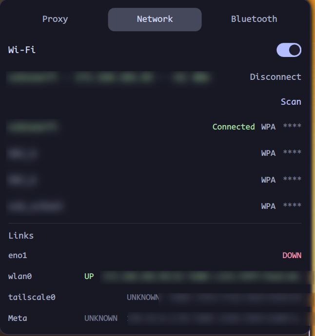
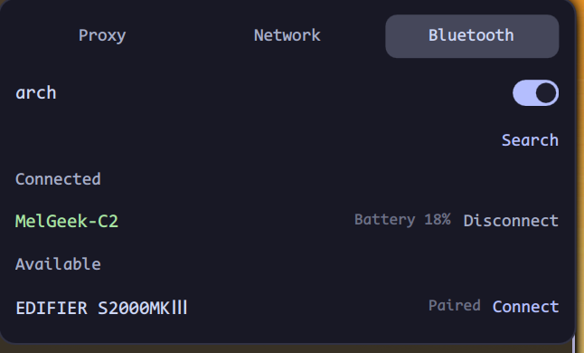

<div align="center">
  
  <h1>lo</h1>
  <p><strong>A ring-first Hyprland top bar — system, AI quota and network in one Quickshell process</strong></p>
  <p>
    <a href="README.md">English</a> | <a href="README.zh-CN.md">简体中文</a>
  </p>
  <p>
    <a href="https://github.com/kimiellen/lo/releases/latest">
      
    </a>
    
    
    
    
    
  </p>
</div>


lo is a Hyprland top bar written entirely in QML on **Quickshell 0.3.2 / Qt 6.12**. It runs as one long-lived process, turns usage into rings, and keeps the things you actually glance at within reach:

1. **System at a glance** — workspaces, CPU / memory / disk, volume / brightness / battery, all as arcs: a letter names each subsystem in the ring centre and the exact value appears on hover
2. **AI quota on the bar** — Kimi Code 7-day and 5-hour windows with their own reset countdowns, plus your DeepSeek balance
3. **Network** — iwd Wi-Fi with inline password entry and BlueZ devices in a single control panel
4. **Your theme, your language** — Catppuccin Mocha / Latte / auto and 中文 / English, switched live and persisted

Nothing on the bar is allowed to break the bar: a missing API key, a failed `df` or an absent battery only greys out that one item.

## Features

### Left cluster — system at a glance


#### Workspaces

- One ring per workspace, at least five slots and more when you create higher workspace IDs
- The arc fills with the window count (`min(windows, 5) / 5`) and changes colour at four tiers: empty, 1–2, 3–4, 5+
- The focused workspace is outlined; left-click jumps to it through Hyprland's Lua API
- Workspaces appear and disappear with Hyprland events — no polling, no restart

#### CPU / memory / disk

- Three rings lettered `C`, `M`, `D`; hover for the exact percentage and, for memory and disk, `used / total` in GiB
- CPU is the delta of two `/proc/stat` samples every second; memory reads `MemAvailable` every two seconds; disk measures `/` every 30 seconds with the same accounting as `df`
- Clicking any ring opens the control panel; if a source disappears the ring turns grey and shows `--` instead of freezing on a stale value

#### Kimi Code quota

- Fetches `GET https://api.kimi.com/coding/v1/usages` every 60 seconds and renders the **windows the API actually returns** — no hard-coded window list
- Up to two rings, picked in a fixed order: **7-day first, then 5-hour**, with monthly / code windows as a fallback so a changed API never hides the quota
- Each ring carries its own reset countdown in the same colour: days for the weekly window (`1D`, `3D`), hours for the session window (`3H`)
- Hover shows the window name, percentage and reset time; 7-day uses sapphire, 5-hour uses flamingo
- The parser accepts the current `usages` shape, the older `usage` shape and `limits[]`, plus `used_ratio`, `used/limit` and `remaining/limit`
- Key comes from `KIMI_CODING_API_KEY` or `~/.config/vbc-io/secrets.json` (`600`, `400` also accepted); missing key, 401, timeout or garbage all degrade to a grey `--` ring and recover on the next poll

#### DeepSeek balance

- Fetches `GET https://api.deepseek.com/user/balance` every five minutes
- A balance has no denominator, so it is deliberately **not** a ring: the official DeepSeek vector mark plus the amount, with `¥` / `$` taken from the API currency
- `is_available: false` keeps the number but switches it to the warning colour; failures show `--`

### Center — clock

- One card pinned to the **exact horizontal centre** of the screen (`anchors.horizontalCenter`, not an equal-width approximation)
- Bilingual, with the date order and 12/24-hour clock following the language:
  - 中文: `11月1日 - 21:26 - 周一`
  - English: `1 Nov - 09:26 PM - Mon`
- Updates every second through `SystemClock`

### Right cluster — status card and status icons


**Status card**

- **Theme button** — cycles `dark → light → auto`; `auto` picks light between 06:00 and 18:00 and dark otherwise, and follows the clock while the bar runs
- **Microphone** — mutes / unmutes the default input; the glyph gains a slash and turns grey when muted
- **Volume** — ring lettered `V` in maroon; click the ring to mute, scroll to change volume by 5% (muted greys the whole ring)
- **Brightness** — ring lettered `L` in blue; scroll to change by 5%, with the value rounded to the same integer shown elsewhere
- **Battery** — ring lettered `B` that swaps to a bolt vector while plugged in; the arc and centre are coloured by tier (`<40%` red, `40–70%` yellow, `≥70%` green); hover shows percent, remaining time and wattage
- Missing hardware hides the module instead of showing a broken one (no PipeWire → no volume module, no backlight → no brightness)

**Status icons**

- Wi-Fi and Bluetooth, each opening the panel on its own tab
- Wi-Fi is green when connected, grey when off; Bluetooth turns blue only while a device is connected

## Control panel

The panel is a 400 px overlay anchored under the right edge of the bar. `Esc` or a click outside closes it, and it takes exclusive keyboard focus while open so the Wi-Fi password field can be typed into. Opening a tab refreshes that tab's data immediately.

### Network



- Wi-Fi power switch, connected network with IP and signal, and a scan button
- Saved or open networks connect directly; WPA networks open an inline password field — the panel keeps keyboard focus exactly for this
- Unsupported security types and failed connections report inline, without throwing
- A read-only link table (`ip -br addr`) lists every interface with state and addresses, refreshed every five seconds

### Bluetooth



- Adapter power switch, connected devices with battery percentage, and available / paired devices
- Search starts a 15-second discovery and stops automatically, because BlueZ has no manual refresh
- Each row carries an explicit connect / disconnect button; clicking a disconnected device's name connects it too — a connected device's name is inert, so you can't fat-finger a disconnect
- BlueZ auto-reconnects BLE/HID devices right after a manual disconnect (controller accept list), so a disconnect also blocks the device until the next connect
- The list re-sorts by name as states change

## Themes and languages

|  | Mocha (dark) | Latte (light) |
|---|---|---|
| Base | `#1e1e2e` | `#eff1f5` |
| Text | `#cdd6f4` | `#4c4f69` |
| Accent | lavender `#b4befe` | lavender `#7287fd` |
| Rings | blue / mauve / teal (CPU·memory·disk), maroon volume, blue brightness, tiered battery | same roles |

- Every visible string goes through `I18n`; every colour goes through `Theme` — there are no hard-coded labels or hex values in the bar
- Theme and language are written to `~/.config/vbc-io/config.json` and restored before the first frame, so rings never flash in the wrong palette on startup
- Both can also be driven from the shell with IPC (see below)

## Interactions

| Element | Left click | Scroll | Hover |
|---|---|---|---|
| Workspace ring | switch to that workspace | — | — |
| CPU / memory / disk ring | open the control panel | — | percentage, and `used / total` for M and D |
| Kimi quota ring / countdown | — | — | window, percentage, reset time |
| DeepSeek balance | — | — | amount or the failure reason |
| Theme button | dark → light → auto | — | current mode |
| Microphone | toggle input mute | — | muted / on |
| Volume ring | toggle mute | ±5% | percentage, or `Muted` |
| Brightness ring | — | ±5% | percentage |
| Battery ring | — | — | percentage, remaining time, wattage |
| Status icon (Wi-Fi / Bluetooth) | open its panel tab | — | SSID, connected device count |
| Clock | — | — | — |

## Requirements

| Requirement | Version | Notes |
|---|---|---|
| Hyprland | 0.57+ | Tested on 0.57.0; workspace switching goes through the Lua API |
| Quickshell | 0.3.2 | Arch package; Qt 6.12 |
| PipeWire | any | Volume and microphone modules; `pactl` not required |
| UPower | any | Battery module |
| BlueZ | any | Bluetooth tab |
| iwd | any | Wi-Fi tab — **NetworkManager is not used** |
| `brightnessctl` | any | Brightness module |
| `curl` | any | Kimi and DeepSeek requests |
| JetBrainsMono Nerd Font | any | Status glyphs; Noto Sans CJK for Chinese |

## Installation

> **Naming:** the project is `lo`, but the Quickshell config identifier stays `vbc-io` (`qs -c vbc-io`, `~/.config/vbc-io/`). Renaming it would break existing installs, so it is intentionally stable.

### 1. Dependencies

On Arch:

```bash
sudo pacman -S quickshell pipewire upower bluez bluez-utils iwd brightnessctl curl
sudo pacman -S ttf-jetbrains-mono-nerd noto-fonts-cjk
```

### 2. Clone into the Quickshell config directory

```bash
git clone https://github.com/kimiellen/lo.git ~/.config/quickshell/vbc-io
```

The directory name must be `vbc-io`: Quickshell derives the `qs.*` import namespace from it, and `qs -c vbc-io` looks there.

### 3. API keys

Create `~/.config/vbc-io/secrets.json`:

```json
{
  "kimi_api_key": "your-kimi-coding-key",
  "deepseek_api_key": "your-deepseek-key"
}
```

```bash
chmod 600 ~/.config/vbc-io/secrets.json
```

Only `600` and `400` are accepted; anything looser is refused and the quota modules stay grey. Environment variables `KIMI_CODING_API_KEY` and `DEEPSEEK_API_KEY` take precedence and are the better choice if you already export them.

### 4. Run it

```bash
qs -c vbc-io
```

The bar appears immediately; QML edits hot-reload while it runs. For autostart, add to `~/.config/hypr/hyprland.conf`:

```ini
exec-once = qs -c vbc-io
```

### Updating

```bash
cd ~/.config/quickshell/vbc-io
git pull
```

Quickshell picks up the new QML on the next reload; no build step exists.

## Configuration

`~/.config/vbc-io/config.json` is written whenever a setting changes. Every key is optional:

| Key | Default | Meaning |
|---|---|---|
| `theme` | `"mocha"` | `mocha`, `latte` or `auto` (`auto` = light 06:00–18:00) |
| `language` | `"zh"` | `"zh"` or `"en"` |
| `barHeight` | `35` | Card height, clamped to 28–64; the bar window adds margins on top |
| `secretsPath` | `<config dir>/secrets.json` | Override the quota key file |

```json
{
  "theme": "auto",
  "language": "en",
  "barHeight": 35,
  "secretsPath": ""
}
```

Set `VBCIO_CONFIG_DIR` to point the whole config directory somewhere else — useful for trying a theme or a language without touching your daily setup.

## IPC

```bash
qs ipc call theme toggle            # dark → light → auto
qs ipc call theme set latte         # mocha / latte / auto
qs ipc call language toggle         # zh ↔ en
qs ipc call language set en
qs ipc call workspaces focus 3      # jump to workspace 3
```

Handy for keybindings:

```ini
bind = SUPER, T, exec, qs ipc call theme toggle
bind = SUPER, L, exec, qs ipc call language toggle
```

## How it works

```text
lo/
├── shell.qml            # ShellRoot: one Bar + one Panel per screen, plus IPC
├── core/                # Theme, I18n, Config, Format, Metrics — no side effects
├── services/            # every external read/write: Hypr, SystemStats, Audio,
│                        #   Brightness, Power, Wifi, Link, BlueZ,
│                        #   QuotaKimi, QuotaDeepSeek, Secrets
├── components/          # UsageRing, InfoRing, StatusGlyph, Tooltip…
├── bar/                 # three-zone layout and its items
├── panels/              # panel host and its tabs
└── docs/specs/topbar/   # spec.md is the source of truth
```

Two rules keep the codebase honest:

- **UI never performs side effects.** Commands, file reads and HTTP live only in `services/`; the bar and panels only bind to properties.
- **No magic values in views.** Colours come from `Theme`, strings from `I18n`, sizes from `Metrics`, numbers from `Format`.

### Data sources

| Module | Source | Refresh | When unavailable |
|---|---|---|---|
| Workspaces | `Quickshell.Hyprland` | events | hidden |
| CPU | `/proc/stat` (two samples) | 1 s | `--` |
| Memory | `/proc/meminfo` (`MemAvailable`) | 2 s | `--` |
| Disk | `df -P /` | 30 s | `--` |
| Volume / mic | `Quickshell.Services.Pipewire` | events | hidden |
| Brightness | `brightnessctl -m` | 1 s | hidden |
| Battery | UPower `displayDevice` | events | hidden |
| Kimi quota | `api.kimi.com/coding/v1/usages` | 60 s | grey `--` |
| DeepSeek balance | `api.deepseek.com/user/balance` | 5 min | `--` |
| Wi-Fi | `iwctl` | 10 s + on open | offline icon |
| Links | `ip -br addr` | 5 s | empty table |
| Bluetooth | `Quickshell.Bluetooth` | events | hidden |

HTTP is always a `curl` child process with `--max-time 8`. Parsing failures are logged once and degrade the module; they never throw into the UI.

### Degradation, by design

- A missing key shows `--` and a grey ring, and the module recovers on the next poll once the key is back — no restart
- `secrets.json` with permissions wider than `600/400` is refused rather than read
- Missing hardware hides the module; it does not render a zero
- The control panel's height follows its content, clamped between 140 and 640 px

## Visual system

Everything is Catppuccin, with semantic roles instead of raw colours:

| Role | Mocha | Latte | Used by |
|---|---|---|---|
| `cpu` | blue `#89b4fa` | blue `#1e66f5` | CPU ring |
| `memory` | mauve `#cba6f7` | mauve `#8839ef` | memory ring |
| `disk` | teal `#94e2d5` | teal `#179299` | disk ring |
| `volume` | maroon `#f38ba8` | maroon `#e64553` | volume ring and its `V` |
| `brightness` | blue `#89b4fa` | blue `#1e66f5` | brightness ring and its `L` |
| battery tier | red / yellow / green (`<40%` / `40–70%` / `≥70%`) | same | battery ring and centre; plugged in swaps the `B` for a bolt |
| `bluetooth` | blue `#89b4fa` | blue `#1e66f5` | Bluetooth icon while connected |
| `kimiWeek` | sapphire `#74c7ec` | sapphire `#209fb5` | 7-day quota |
| `kimiSession` | flamingo `#f2cdcd` | flamingo `#dd7878` | 5-hour quota |
| `deepseekBrand` | `#4d6bfe` | `#4d6bfe` | DeepSeek mark |
| workspace tier | overlay / blue / yellow / red | same | workspace rings |

Geometry is a small, fixed vocabulary:

| Token | Value |
|---|---|
| Card | 35 px tall, radius 16, 10 px horizontal padding |
| Ring | 24 px outer diameter, 3 px stroke |
| Workspace | 24 px slot, 18 px ring |
| Text | 14 px everywhere; ring centre fixed at 14 px |
| Bar margins | 15 px left/right, 12 px top/bottom, 8 px between cards |
| Panel | 400 px wide, radius 12, 12 px padding, 30 px tabs |

At fractional scaling a 24 px ring lands on 38.4 device pixels, so the bar **snaps geometry to device pixels**: card height, margins, gaps, ring diameters and 1 px borders are all rounded to whole device pixels (`Metrics.snap` / `snapEven`). The result is a crisp 1 px outline at 1.6× instead of a blurred one.

## Docs

The authoritative, detailed specification lives in the repo:

- [Top bar spec](docs/specs/topbar/spec.md) — layout, visual rules, data contracts, risks
- [Milestone archive](docs/specs/topbar/tasks-archive.md) — what was built and how each milestone was verified

## Development

```bash
ln -sfn "$PWD" ~/.config/quickshell/vbc-io   # work from this checkout
qs -c vbc-io                                 # run in the foreground, read the logs
```

- No build step and no C++: QML reloads on save while the process runs
- `VBCIO_CONFIG_DIR=$PWD/.dev/config qs -c vbc-io` gives an isolated config, useful for testing themes and languages without touching `~/.config`
- Changes to the spec go through `docs/specs/topbar/spec.md` first, then the code

## Non-goals

Notification centre, media controls, temperature / GPU, OBS status, input-method indicator, auto-hide and per-monitor layouts are intentionally out of scope.

## License

[MIT](LICENSE) © 2026 kimiellen
