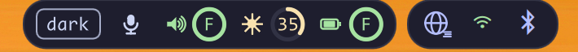
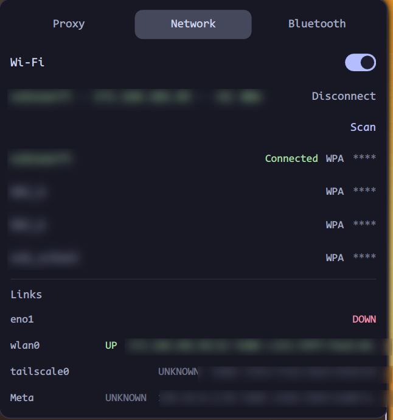
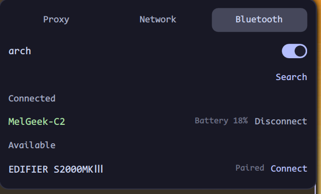

<div align="center">
  
  <h1>lo</h1>
  <p><strong>环形优先的 Hyprland 顶栏——系统、AI 额度与网络，装进一个 Quickshell 进程</strong></p>
  <p>
    <a href="README.md">English</a> | <a href="README.zh-CN.md">简体中文</a>
  </p>
  <p>
    <a href="https://github.com/kimiellen/lo/releases/latest">
      
    </a>
    
    
    
    
    
  </p>
</div>


lo 是一个完全用 QML 写成的 Hyprland 顶栏，运行在 **Quickshell 0.3.2 / Qt 6.12** 上。它是单进程常驻的，把用量画成环，并把你真正会瞄一眼的几类信息放在手边：

1. **系统状态**——工作区、CPU / 内存 / 磁盘、音量 / 亮度 / 电池，全部是环形：环心字母标明子系统，精确数值悬浮可见
2. **AI 额度**——Kimi Code 的 7 天与 5 小时窗口，各自带重置倒计时；外加 DeepSeek 余额
3. **网络**——iwd Wi-Fi（含内联密码输入）与 BlueZ 蓝牙，收在同一个控制面板里
4. **主题与语言**——Catppuccin Mocha / Latte / 自动，中文 / English，切换即时生效并持久化

顶栏的底线是：任何一项依赖坏掉都只让它自己变灰，不影响其余部分——没有 API key、`df` 失败、没有电池，都不会让整条栏失色。

## 功能特点

### 左区——系统状态一目了然


#### 工作区

- 每个工作区一个环，至少 5 个槽位；创建更靠后的工作区时自动扩展
- 进度弧 = `min(窗口数, 5) / 5`，颜色分四档：空、1–2、3–4、5 个以上窗口
- 当前工作区有一圈描边；左键通过 Hyprland 的 Lua API 直接切过去
- 工作区随 Hyprland 事件增减——不轮询、不用重启

#### CPU / 内存 / 磁盘

- 三个环分别以 `C`、`M`、`D` 为环心；悬浮可看精确百分比，内存与磁盘还会给出 `已用 / 总量`（GiB）
- CPU 每秒对两次 `/proc/stat` 采样求差；内存每 2 秒读 `MemAvailable`；磁盘每 30 秒量一次 `/`，口径与 `df` 一致
- 点任意环打开控制面板；数据源消失时环变灰并显示 `--`，不会停在旧数值上

#### Kimi Code 额度

- 每 60 秒请求 `GET https://api.kimi.com/coding/v1/usages`，渲染**接口实际返回的窗口**，不硬编码窗口集合
- 最多两个环，取窗顺序固定：**先 7 天、再 5 小时**；月度 / 代码窗口作为回退，接口改结构也不会把额度吞掉
- 每个环紧跟自己的重置倒计时，颜色与环一致：周额度按天（`1D`、`3D`），5 小时窗口按小时（`3H`）
- 悬浮显示窗口名、百分比与重置时间；7 天用 sapphire、5 小时用 flamingo
- 解析器同时兼容新版 `usages`、旧版 `usage` 与 `limits[]`，以及 `used_ratio`、`used/limit`、`remaining/limit` 三种给值方式
- Key 来自 `KIMI_CODING_API_KEY` 或 `~/.config/vbc-io/secrets.json`（权限 `600`，也接受更严的 `400`）；无 key、401、超时、乱码一律降级为灰色 `--` 环，下一次轮询自动恢复

#### DeepSeek 余额

- 每 60 秒请求 `GET https://api.deepseek.com/user/balance`
- 余额只有金额没有分母，所以**刻意不画环**：官方 DeepSeek 矢量标 + 金额，`¥` / `$` 按接口返回的币种
- `is_available: false` 时仍显示金额，但改用警告色；请求失败显示 `--`

### 中区——时钟

- 一张卡片严格锚定屏幕**水平中心**（`anchors.horizontalCenter`，不用等分布局近似）
- 中英双语的日期顺序与 12/24 小时制都跟随语言：
  - 中文：`11月1日 - 21:26 - 周一`
  - English：`1 Nov - 09:26 PM - Mon`
- 通过 `SystemClock` 每秒刷新

### 右区——状态卡与状态图标



**状态卡**

- **主题按钮**——`深色 → 浅色 → 自动` 循环；`自动` 在 06:00–18:00 用浅色、其余用深色，运行期间跟随时钟
- **麦克风**——切换默认输入源静音；静音时图标加斜线并变灰
- **音量**——环心字母 `V`（maroon）；点环静音，滚动以 5% 步进调节（静音时整环变灰）
- **亮度**——环心字母 `L`（blue）；滚动以 5% 步进调节，数值与其他地方保持同一种取整口径
- **电池**——环心字母 `B`，插电时换成闪电矢量；环与环心按分档着色（`<40%` 红、`40–70%` 黄、`≥70%` 绿）；悬浮显示百分比、剩余时间与功率
- 硬件缺失时整块模块隐藏，而不是显示一个坏掉的 0（没有 PipeWire 就没有音量，没有背光就没有亮度）

**状态图标**

- Wi-Fi、蓝牙两枚，各自点开控制面板的对应 tab
- Wi-Fi 已连接为绿色、关闭为灰色；蓝牙只在有设备连接时变为蓝色

## 控制面板

面板是 400 px 宽的浮层，锚定在顶栏右下方。`Esc` 或点击面板外关闭；打开时独占键盘焦点，Wi-Fi 密码框才有得输入。打开或切换 tab 会立刻刷新该页数据。

### 网络



- Wi-Fi 开关、当前网络（含 IP 与信号强度）、扫描按钮
- 已保存或开放网络直接连；WPA 网络展开内联密码框——面板独占键盘焦点正是为了这一步
- 不支持的加密方式、连接失败都在页内提示，不抛错
- 下方是只读链路表（`ip -br addr`），列出每块网卡的状态与地址，每 5 秒刷新

### 蓝牙



- 适配器开关、已连接设备（含电量）、可用 / 已配对设备
- 搜索会发起 15 秒扫描并自动停止，因为 BlueZ 没有手动刷新接口
- 每行右侧有明确的 连接 / 断开 按钮；未连接设备的名称也可点击直接连接，已连接设备的名称不响应点击，避免误触断开
- BlueZ 会对 BLE / HID 设备保持自动回连（控制器 accept list），手动断开会同时阻止该设备，直到下次主动连接
- 设备状态变化时列表按名称重新排序

## 主题与语言

|  | Mocha（深色） | Latte（浅色） |
|---|---|---|
| 底色 | `#1e1e2e` | `#eff1f5` |
| 文字 | `#cdd6f4` | `#4c4f69` |
| 强调 | lavender `#b4befe` | lavender `#7287fd` |
| 环 | blue / mauve / teal（CPU·内存·磁盘）、maroon 音量、blue 亮度、电池分档 | 同一套语义角色 |

> 文中截图统一取自英文界面；中文界面只替换文案与日期格式，布局规则与尺寸规范一致。

- 所有可见文案走 `I18n`，所有颜色走 `Theme`——栏里没有散落的硬编码字符串与色值
- 主题与语言写入 `~/.config/vbc-io/config.json`，并在第一帧之前恢复，启动时不会先用错配色画一遍环
- 两者也都能从命令行通过 IPC 切换（见下）

## 交互

| 元素 | 左键 | 滚轮 | 悬浮 |
|---|---|---|---|
| 工作区环 | 切换到该工作区 | — | — |
| CPU / 内存 / 磁盘环 | 打开控制面板 | — | 百分比，内存与磁盘另有 `已用 / 总量` |
| Kimi 额度环 / 倒计时 | — | — | 窗口、百分比、重置时间 |
| DeepSeek 余额 | — | — | 金额或失败原因 |
| 主题按钮 | `深色 → 浅色 → 自动` | — | 当前模式 |
| 麦克风 | 切换输入静音 | — | 已静音 / 已开启 |
| 音量环 | 切换静音 | ±5% | 百分比，或「静音」 |
| 亮度环 | — | ±5% | 百分比 |
| 电池环 | — | — | 百分比、剩余时间、功率 |
| 状态图标（Wi-Fi / 蓝牙） | 打开对应 tab | — | SSID、已连设备数 |
| 时钟 | — | — | — |

## 环境要求

| 依赖 | 版本 | 说明 |
|---|---|---|
| Hyprland | 0.57+ | 在 0.57.0 上实测；切工作区走 Lua API |
| Quickshell | 0.3.2 | Arch 包；Qt 6.12 |
| PipeWire | 任意 | 音量与麦克风模块依赖它 |
| UPower | 任意 | 电池模块 |
| BlueZ | 任意 | 蓝牙 tab |
| iwd | 任意 | Wi-Fi tab——**不使用 NetworkManager** |
| `brightnessctl` | 任意 | 亮度模块 |
| `curl` | 任意 | Kimi 与 DeepSeek 请求 |
| JetBrainsMono Nerd Font | 任意 | 状态图标字形；中文另需 Noto Sans CJK |

## 安装

> **命名说明：** 项目叫 `lo`，但 Quickshell 配置标识保持 `vbc-io`（`qs -c vbc-io`、`~/.config/vbc-io/`）。改名会破坏已有安装，所以这里刻意保持稳定。

### 1. 安装依赖

Arch：

```bash
sudo pacman -S quickshell pipewire upower bluez bluez-utils iwd brightnessctl curl
sudo pacman -S ttf-jetbrains-mono-nerd noto-fonts-cjk
```

### 2. 克隆到 Quickshell 配置目录

```bash
git clone https://github.com/kimiellen/lo.git ~/.config/quickshell/vbc-io
```

目录名必须是 `vbc-io`：Quickshell 由它推导 `qs.*` 导入命名空间，`qs -c vbc-io` 也从这里启动。

### 3. 配置 API key

新建 `~/.config/vbc-io/secrets.json`：

```json
{
  "kimi_api_key": "你的 Kimi Coding key",
  "deepseek_api_key": "你的 DeepSeek key"
}
```

```bash
chmod 600 ~/.config/vbc-io/secrets.json
```

只接受 `600` 与 `400`；更宽的权限会被拒绝读取，额度模块保持灰色。环境变量 `KIMI_CODING_API_KEY`、`DEEPSEEK_API_KEY` 优先，已经导出的话可以直接用环境变量。

### 4. 启动

```bash
qs -c vbc-io
```

顶栏立即出现；运行期间改 QML 会热重载。开机自启写进 `~/.config/hypr/hyprland.conf`：

```ini
exec-once = qs -c vbc-io
```

### 更新

```bash
cd ~/.config/quickshell/vbc-io
git pull
```

Quickshell 下次重载即生效；这个项目没有构建步骤。

## 配置

设置一旦变化就会写入 `~/.config/vbc-io/config.json`，所有键都可省略：

| 键 | 默认值 | 含义 |
|---|---|---|
| `theme` | `"mocha"` | `mocha`、`latte` 或 `auto`（自动 = 06:00–18:00 浅色） |
| `language` | `"zh"` | `"zh"` 或 `"en"` |
| `barHeight` | `35` | 卡片高，限制在 28–64；顶栏窗口在此基础上加留白 |
| `secretsPath` | `<配置目录>/secrets.json` | 覆盖额度 key 文件路径 |

```json
{
  "theme": "auto",
  "language": "zh",
  "barHeight": 35,
  "secretsPath": ""
}
```

用 `VBCIO_CONFIG_DIR` 可以把整个配置目录指到别处——适合在不碰日常配置的情况下试主题或语言。

## IPC

```bash
qs ipc call theme toggle            # 深色 → 浅色 → 自动
qs ipc call theme set latte         # mocha / latte / auto
qs ipc call language toggle         # 中 ↔ 英
qs ipc call language set en
qs ipc call workspaces focus 3      # 跳到工作区 3
```

绑快捷键很方便：

```ini
bind = SUPER, T, exec, qs ipc call theme toggle
bind = SUPER, L, exec, qs ipc call language toggle
```

## 实现

```text
lo/
├── shell.qml            # ShellRoot：每屏一个 Bar + 一个 Panel，外加 IPC
├── core/                # Theme、I18n、Config、Format、Metrics——无副作用
├── services/            # 所有外部读写：Hypr、SystemStats、Audio、
│                        #   Brightness、Power、Wifi、Link、BlueZ、
│                        #   QuotaKimi、QuotaDeepSeek、Secrets
├── components/          # UsageRing、InfoRing、StatusGlyph、Tooltip…
├── bar/                 # 三区布局与各 item
├── panels/              # 面板宿主与各 tab
└── docs/specs/topbar/   # spec.md 是事实源
```

两条规则约束着整个代码库：

- **UI 不做副作用。** 命令执行、文件读取、HTTP 只出现在 `services/`；顶栏与面板只做属性绑定。
- **视图里没有魔法值。** 颜色取 `Theme`、文案取 `I18n`、尺寸取 `Metrics`、数值格式取 `Format`。

### 数据源

| 模块 | 来源 | 刷新 | 不可用时 |
|---|---|---|---|
| 工作区 | `Quickshell.Hyprland` | 事件 | 隐藏 |
| CPU | `/proc/stat`（两次采样） | 1 s | `--` |
| 内存 | `/proc/meminfo`（`MemAvailable`） | 2 s | `--` |
| 磁盘 | `df -P /` | 30 s | `--` |
| 音量 / 麦克风 | `Quickshell.Services.Pipewire` | 事件 | 隐藏 |
| 亮度 | `brightnessctl -m` | 1 s | 隐藏 |
| 电池 | UPower `displayDevice` | 事件 | 隐藏 |
| Kimi 额度 | `api.kimi.com/coding/v1/usages` | 60 s | 灰色 `--` |
| DeepSeek 余额 | `api.deepseek.com/user/balance` | 60 s | `--` |
| Wi-Fi | `iwctl` | 10 s + 打开时 | 离线图标 |
| 链路 | `ip -br addr` | 5 s | 空表 |
| 蓝牙 | `Quickshell.Bluetooth` | 事件 | 隐藏 |

HTTP 一律是 `curl` 子进程，带 `--max-time 8`。解析失败只记一条日志并降级，绝不向 UI 抛错。

### 刻意设计的降级

- 没有 key 显示 `--` 与灰环；key 恢复后下一次轮询自动恢复，不用重启
- `secrets.json` 权限宽于 `600/400` 时拒绝读取，而不是照读
- 硬件缺失就隐藏模块，不渲染一个 0
- 控制面板高度随内容收缩，限制在 140–640 px

## 视觉规范

配色全部来自 Catppuccin，并且只暴露语义角色：

| 角色 | Mocha | Latte | 用于 |
|---|---|---|---|
| `cpu` | blue `#89b4fa` | blue `#1e66f5` | CPU 环 |
| `memory` | mauve `#cba6f7` | mauve `#8839ef` | 内存环 |
| `disk` | teal `#94e2d5` | teal `#179299` | 磁盘环 |
| `volume` | maroon `#f38ba8` | maroon `#e64553` | 音量环与环心 `V` |
| `brightness` | blue `#89b4fa` | blue `#1e66f5` | 亮度环与环心 `L` |
| 电池分档 | 红 / 黄 / 绿（`<40%` / `40–70%` / `≥70%`） | 同左 | 电池环与环心；插电时环心 `B` 换为闪电 |
| `bluetooth` | blue `#89b4fa` | blue `#1e66f5` | 蓝牙图标（已连接） |
| `kimiWeek` | sapphire `#74c7ec` | sapphire `#209fb5` | 7 天额度 |
| `kimiSession` | flamingo `#f2cdcd` | flamingo `#dd7878` | 5 小时额度 |
| `deepseekBrand` | `#4d6bfe` | `#4d6bfe` | DeepSeek 标 |
| 工作区分档 | overlay / blue / yellow / red | 同左 | 工作区环 |

几何是一套固定词汇：

| 项 | 值 |
|---|---|
| 卡片 | 高 35、圆角 16、横向内边距 10 |
| 环 | 外径 24、线宽 3 |
| 工作区 | 槽位 24、内环 18 |
| 字号 | 全部 14；环心固定 14 |
| 顶栏留白 | 左右 15、上下 12、卡片之间 8 |
| 面板 | 宽 400、圆角 12、内边距 12、tab 高 30 |

在分段缩放下，24 px 的环会落在 38.4 个设备像素上，所以顶栏把**几何吸附到设备像素**：卡片高、留白、间隙、环径与 1 px 描边都按整设备像素取整（`Metrics.snap` / `snapEven`）。结果是 1.6× 下描边依然是均匀的 1 px，而不是发虚的半像素。

## 文档

仓库里放着更详细的权威规格：

- [顶栏规格](docs/specs/topbar/spec.md)——布局、视觉规则、数据契约与风险
- [里程碑归档](docs/specs/topbar/tasks-archive.md)——每个里程碑做了什么、怎么验证的

## 开发

```bash
ln -sfn "$PWD" ~/.config/quickshell/vbc-io   # 从当前 checkout 工作
qs -c vbc-io                                 # 前台运行，直接看日志
```

- 没有构建步骤、没有 C++：进程运行期间保存 QML 即热重载
- `VBCIO_CONFIG_DIR=$PWD/.dev/config qs -c vbc-io` 使用隔离配置，适合在不碰 `~/.config` 的情况下试主题与语言
- 规格变更先改 `docs/specs/topbar/spec.md`，再改代码

## 非目标

通知中心、媒体控制、温度 / GPU、OBS 状态、输入法指示、自动隐藏与多显示器差异化布局，都不在范围内。

## 许可证

[MIT](LICENSE) © 2026 kimiellen
